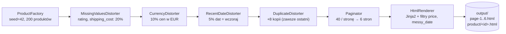

# Lab 1 – parser strony WWW (PJN, Politechnika Krakowska)

Projekt łączy dwie role:

- **AUTOR** – generuje statyczny sklep internetowy (200 produktów, 18 atrybutów, paginacja, podstrony szczegółów) i celowo „psuje” dane, żeby utrudnić parsowanie,
- **PARSER** – scraper, który widzi wyłącznie HTML serwowany przez HTTP, przechodzi przez wszystkie podstrony, czyści dane i eksportuje je do CSV i JSON. Na końcu moduł analizy sprawdza jakość danych i liczy statystyki.

Scraper **nie importuje niczego** z `site_generator/` – zna tylko strukturę HTML, tak jak prawdziwy parser cudzej strony.

## Architektura

### Potok generatora (AUTOR)



### Potok scrapera (PARSER)

```mermaid
flowchart LR
    S[("http.server :8000")] --> FE["Fetcher<br/>opóźnienie ≥0,5 s, User-Agent,<br/>raise_for_status, bytes"]
    FE --> CE["CatalogPageExtractor<br/>.product[data-id], a.next"]
    CE --> DD["deduplicate<br/>po id"]
    DD --> DE["DetailPageExtractor<br/>a.product-link → 8 pól"]
    DE --> CL["clean_record<br/>czyste funkcje parse_*"]
    CL --> EX["CsvExporter / JsonExporter"]
    EX --> D[("data/products.csv<br/>data/products.json<br/>data/run_summary.json")]
    D --> AN["analysis.report<br/>pandas + matplotlib"]
    AN --> FG[("reports/figures/*.png")]
```



| Katalog | Odpowiedzialność |
|---|---|
| `site_generator/` | model `Product`, fabryka danych, distortery (ABC `Distorter`), paginacja, renderowanie Jinja2 |
| `scraper/fetcher.py` | warstwa HTTP: grzeczne pobieranie |
| `scraper/extractors.py` | HTML → surowe napisy; selektory jako stałe na górze pliku |
| `scraper/cleaners.py` | napisy → typy (`float`, `int`, `bool`, `date`, `None`); czyste funkcje |
| `scraper/exporters.py` | ABC `Exporter` + CSV (`utf-8-sig`) i JSON (`ensure_ascii=False`) |
| `scraper/main.py` | orkiestracja: crawl → deduplikacja → szczegóły → czyszczenie → eksport |
| `analysis/` | kontrola jakości, statystyki opisowe, wykresy |
| `tests/` | testy jednostkowe funkcji czyszczących (pytest) |

## Utrudnienia wprowadzone przez AUTORA

| Utrudnienie | Jak wygląda w HTML | Jak radzi sobie parser |
|---|---|---|
| Braki wartości (20% w `rating` i `shipping_cost`, losowane `random.sample`) | pusty element `<td class="rating"></td>` | `_text` zwraca `None` dla pustego tekstu → pusta komórka w CSV, `null` w JSON |
| 8 duplikatów (kopie produktów z pierwszych 160, trafiają na ostatnią stronę) | ten sam `data-id` na dwóch podstronach | deduplikacja po `id` **przed** pobieraniem szczegółów |
| Format ceny `1 299,00 zł` z twardą spacją (U+00A0) + 10% cen w EUR (`302,10 €`) | `<td class="price">1\xa0389,64\xa0zł</td>` | `parse_price` usuwa symbole i spacje, zamienia przecinek na kropkę; `parse_currency` zapisuje walutę w osobnej kolumnie |
| Niespójne daty: ISO `2026-06-14`, polski `14.06.2026`, słowo `wczoraj` | `<td class="added-date">wczoraj</td>` | `parse_date` próbuje kolejnych formatów; `wczoraj` = dziś − 1 dzień |
| Dwa układy na jednej stronie: tabela i karty | `<tr class="product">` i `<article class="product">` | jeden selektor `.product[data-id]` łapie oba |

## Rozszerzenia PARSERA

- **Testy jednostkowe** funkcji czyszczących (`tests/test_cleaners.py`, 19 testów, w tym `clean_record` dla rekordu bez pól szczegółów),
- **eksport do dwóch formatów**: CSV (otwiera się poprawnie w Excelu dzięki BOM) i JSON,
- dodatkowo: grzeczny `Fetcher` (opóźnienie, User-Agent), podążanie za linkiem „następna”, pobieranie podstron szczegółów, analiza danych z wykresami.

## Instalacja

```bash
python3 -m venv .venv
source .venv/bin/activate          # Windows: .venv\Scripts\activate
pip install -r requirements.txt
```

## Uruchomienie

```bash
# 1. AUTOR: zbuduj stronę do output/
python -m site_generator.build
python -m site_generator.apply_style     # opcjonalnie: arkusz CSS

# 2. Serwuj stronę (osobny terminal, zostaw włączony)
python -m http.server 8000 --directory output

# 3. PARSER: pobierz, wyczyść, zapisz do data/
python -m scraper.main

# 4. Analiza: wyniki w konsoli, wykresy w reports/figures/
python -m analysis.report

# 5. Testy
python -m pytest
```

Katalogi `output/` i `data/` są w `.gitignore` – każdy odtworzy je powyższymi poleceniami. Wykresy w `reports/figures/` są commitowane, bo trafiają do sprawozdania.

> Uwaga: strona i scraper najlepiej uruchamiać tego samego dnia – patrz wnioski o dacie „wczoraj”.

## Wyniki (przebieg z 25.10.2026)

- zebrano **208** rekordów z 6 podstron, usunięto **8** duplikatów → **200** unikalnych produktów, **20** kolumn (18 atrybutów + `currency` + `detail_url`),
- braki: `rating` 40 (20%), `shipping_cost` 40 (20%), pozostałe kolumny 0,
- waluty: 180 PLN, 20 EUR,
- reguła IQR nie wykryła wartości odstających w żadnej cesze liczbowej,
- największa korelacja: `price_pln` – `shipping_cost`, r = 0,16; żadna para nie ma |r| ≥ 0,3.

Pełny opis: [`reports/sprawozdanie.md`](reports/sprawozdanie.md).

## Wnioski

1. **Selektory oparte na klasach i atrybutach danych** (`.product[data-id]`, `.price`) są odporne na zmianę wyglądu – ten sam kod czyta tabelę i karty.
2. **Kodowanie trzeba kontrolować samemu**: `http.server` wysyła `Content-Type: text/html` bez `charset`, więc `response.text` dekoduje jako ISO-8859-1 („GÅoÅnik”). Parser przekazuje do BeautifulSoup surowe bajty (`response.content`), a ten odczytuje `<meta charset="UTF-8">`.
3. **Waluta to błąd, którego statystyka nie wykryje**: ceny w EUR mieszczą się w zakresie cen PLN, więc IQR ich nie łapie. Pomaga dopiero osobna kolumna `currency` i przeliczenie do `price_pln` (bez tego średnia cena jest zaniżona o 173 zł).
4. **Daty względne zależą od chwili wygenerowania strony**: strona zbudowana 24.10, scraper uruchomiony 25.10 → 12 produktów z „wczoraj” dostało datę 24.10 zamiast 23.10. Parser nie zna daty generowania; można by ją wziąć z nagłówka `Last-Modified`.
5. **Korelacje bliskie zeru są poprawnym wynikiem** – generator losuje każdą cechę niezależnie.
